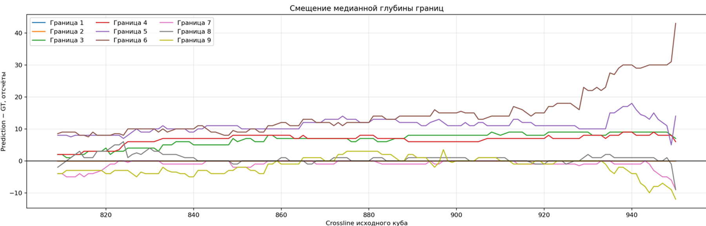
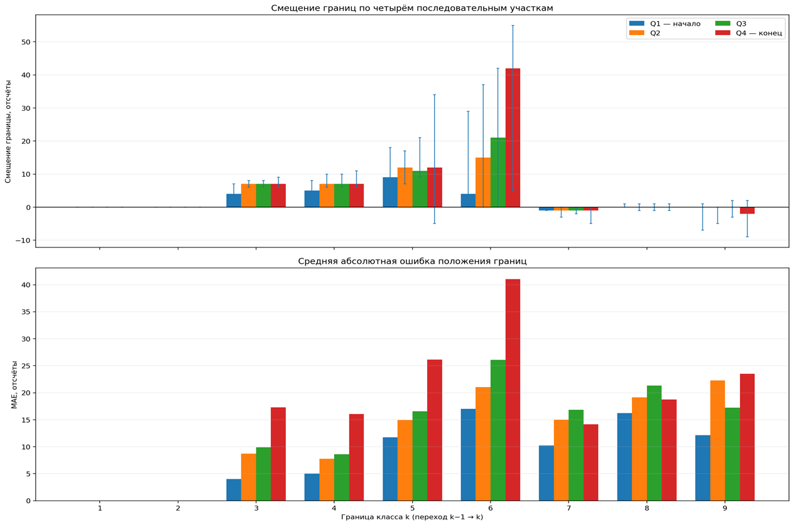

# Сегментация сейсмических фаций, 3D U-Net

Сегментация куба Netherlands F3 на 10 классов. Модель — 3D U-Net. Официальная метрика считается по целому восстановленному объёму, а не по отдельным патчам.

Куб в репозиторий не входит. Нужен один файл `all_data.h5` с датасетами `raw` и `label`. Собрать его из crossline TIFF и масок PNG:

```bash
python convert_to_h5.py --data_dir path/to/data --output_dir path/to/my_data
```

## Данные

Порядок осей: `(crossline, depth, inline)`.

| Ось | Что это | Размер |
|---|---|---|
| 0 | crossline | 951 |
| 1 | глубина | 462 |
| 2 | inline | 651 |

Инлайны отдельно добавлять не нужно: ось 2 уже инлайн. Один инлайн проходит и через обучение, и через тест, поэтому картинки инлайнов в train дают утечку.

Патч `[16, 128, 128]`, шаг `[8, 64, 64]`. Класс 0 — фон, в основной mIoU не входит.

## Разбиение

Официальное, `--split spatial` при кубе из 951 среза и долях по умолчанию (`--per_val 0.2`, `--per_test 0.15`):

| Часть | Срезы crossline |
|---|---|
| train | `[0:619]` |
| val | `[619:809]` |
| test | `[809:951]` |

Тест — дальний участок куба, не случайные срезы.

`--split e5` — диагностический разрез: train `[0:310]` и `[452:761]`, тест-дырка `[310:452]`. Он проверяет, умеет ли модель классы, когда тест лежит между обучающими блоками. Это не официальная цифра. Его val `[761:951]` пересекается с официальным тестом.

`--split random` перемешивает соседние crossline. Соседи попадают и в train, и в test, метрика завышена. В отчёт её не ставить.

`--split ready` берёт уже нарезанные `--train_h5` и `--val_h5`.

## Установка

Обучение запускает пакет `pytorch3dunet` из папки `pytorch-3dunet-master`.

```bash
cd pytorch-3dunet-master
pip install -e .
cd ../source
```

## Обучение

Из папки `source`:

```bash
python run_3d_training.py --data_h5 path/to/all_data.h5 --split spatial
```

По умолчанию: `UNet3D`, 32 карты признаков, `DiceCrossEntropyLoss` (0.5 / 0.5), Adam, `lr=1e-4`, 50 эпох, патч `[16, 128, 128]`, шаг `[8, 64, 64]`, seed 42.

Скрипт режет куб во временные файлы `temp_splits/<split>/`, пишет yaml в `my_configs/generated_config_<split>.yaml`, кладёт копию в `<checkpoint_dir>/config.yaml` и вызывает `python -m pytorch3dunet.train`. Тесту лучше передавать именно копию из папки чекпоинта: так конфиг гарантированно соответствует модели.

Полезные флаги: `--n_epoch`, `--batch_size`, `--loss`, `--aug`, `--vstretch`, `--absolute_depth`, `--class_weights`, `--resume`, `--norm`, `--early_stop`.

`--norm global` (по умолчанию) нормирует амплитуды фиксированным диапазоном: перцентили 0.5 и 99.5 по train (`--norm_low_pct`, `--norm_high_pct`). Тот же диапазон записывается в конфиг и применяется к val и test. `--norm patch` возвращает прежний min-max по каждому патчу; он нужен, чтобы воспроизвести официальный baseline.

`--early_stop N` останавливает обучение после N эпох без улучшения val-метрики, `0` отключает остановку.

`--aug` добавляет поворот в плоскости `(глубина, inline)` и отражение по осям 0 и 2, то есть по crossline и inline. Ось 1, глубина, не отражается: перевёрнутый патч меняет стратиграфический порядок классов.

`--vstretch` растягивает или сжимает обучающий патч по глубине целиком, в диапазоне 0.7–1.6, и возвращает прежний размер. Валидация и тест не растягиваются.

`--absolute_depth` добавляет второй канал: абсолютная глубина по оси 1, нормированная в `[-1, 1]`. Канал добавляется после нормализации и аугментаций, поэтому не нормируется и не поворачивается. В основной результат этот прогон не входит.

## Тест

```bash
python run_3d_test.py ^
  --checkpoint path/to/checkpoint.pytorch ^
  --h5 temp_splits/spatial/test.h5 ^
  --config path/to/checkpoint_dir/config.yaml ^
  --output_dir test_logs/spatial ^
  --monotonic
```

На Linux и macOS вместо `^` используется `\`.

Патч, шаг, число классов, нормализация и наличие канала глубины берутся из конфига. Флаг `--absolute_depth` больше не нужен, он определяется по конфигу.

Скрипт прогоняет 1190 патчей тестового объёма `[142, 462, 651]` (для патча `[16, 128, 128]` и шага `[8, 64, 64]`). Вероятности softmax складываются в координаты исходного куба, делятся на число перекрытий, затем берётся argmax. Метрика одна, по всему объёму. Размер батча (`--batch_size`, по умолчанию 4) влияет только на скорость.

Разметка монотонна по глубине на всём кубе: вдоль каждой трассы номер класса не убывает. Поэтому `--monotonic` — допустимое ограничение при декодировании, а не подгонка по ответу. Оно заставляет предсказанную трассу тоже не убывать с глубиной. Печатаются обе метрики. Объём прямого argmax сохраняется в `prediction_volume_argmax.npy`.

Старые конфиги (`generated_config.yaml` с нормализацией по патчу) читаются как раньше: тест применяет ту же нормализацию, с которой модель обучалась.

Перекрытие: минимум 1, максимум 27, среднее 7.304.

В `--output_dir` пишутся:

- `prediction_volume.npy`, `ground_truth_volume.npy`, `prediction_count.npy`
- `class_metrics.csv`, `confusion_matrix_percent.csv`
- карты уверенности и энтропии
- картинки срезов в `visualizations/`

Цифра validation во время обучения — средний IoU по патчам. Её нельзя сравнивать с volume mIoU теста.

## Результат

Основной результат — без аугментации и без весов классов, нормировка по патчу, прямой argmax. mIoU считается без фона, по целому тестовому объёму `[809:951]`.

| Прогон | mIoU | Pixel accuracy | Что из этого следует |
|---|---:|---:|---|
| Baseline, без аугментации и без весов | 0.640952 | 0.794988 | Официальный результат |
| Монотонное декодирование того же ответа | 0.656778 | 0.803983 | Постобработка, не новое обучение |
| Поворот и отражение по осям 0 и 2 | 0.634294 | — | Ниже baseline. Глубина не отражалась |
| Канал абсолютной глубины | 0.65872 | — | В основной результат не входит |

Приросты монотонного правила посчитаны от официального baseline:

- mIoU: `0.656778 − 0.640952 = +0.0158`;
- pixel accuracy: `0.803983 − 0.794988 = +0.0090`.

Это 1.58 и 0.90 процентного пункта. Относительный прирост был бы другим и здесь не используется.

Аугментация `--aug` отражает патч только по crossline и inline. Цифра 0.634294 относится именно к этому варианту. Официальные 0.640952 получены без поворотов, без отражений и без весов классов.

### Глобальная нормализация

Фиксированный диапазон амплитуд по перцентилям train не изменил качество относительно нормировки по патчу. Отдельной цифры у этого сравнения нет: различия были внутри разброса повторных запусков. Все прогоны ниже уже идут с глобальной нормализацией и с монотонным декодированием. С официальными 0.640952 их можно сравнивать только после вычитания вклада самого монотонного правила.

### Вертикальное растяжение

`--vstretch` показывает сети более тонкие и более толстые слои, но весь патч умножается на один коэффициент. На официальном тесте, с глобальной нормализацией и монотонным декодированием:

| | mIoU | Pixel accuracy |
|---|---:|---:|
| Монотонный baseline | 0.656778 | 0.803983 |
| Вертикальное растяжение | 0.672901 | 0.822990 |

Прирост относительно монотонного baseline: mIoU `+0.0161`, pixel accuracy `+0.0190`. Прямой argmax этого же прогона — 0.65546. Средняя точность по классам в том же логе равна 0.81148; это не pixel accuracy.

Растяжение не убирает основную ошибку. На тесте четвёртый слой тоньше, чем в обучении, а шестой толще. Один коэффициент на весь патч такую пару не воспроизводит.

### Смещение границ

На официальном тесте `[809:951]` медианная глубина предсказанной границы сравнивается с медианой разметки. По вертикали — разность в отсчётах глубины: положительное значение значит, что сеть ставит границу глубже разметки. По горизонтали — номер crossline исходного куба.



Границы 1–5 и 7–9 остаются в пределах примерно ±10 отсчётов. Граница 6 уходит вниз по мере удаления от обучения и на дальнем крае превышает +40 отсчётов.

Те же 142 тестовых среза разбиты на четыре последовательных участка, от ближайшего к обучению (Q1) до дальнего края (Q4). Верхний график — знаковое смещение медианы, нижний — средняя абсолютная ошибка положения. Номер границы `k` — это контакт классов `k−1` и `k`.



У границы 6 смещение и абсолютная ошибка растут от Q1 к Q4. В последней четверти типичный сдвиг около +42 отсчётов, и абсолютная ошибка того же порядка. Границы 1 и 2 почти не смещены. Это согласуется с толщиной слоёв: в обучении шестой слой обычно около 50 отсчётов, на тесте его обычная толщина около 80–90; четвёртый слой на тесте, наоборот, тоньше.

### Проверка по удалению от обучения

Случайные фолды здесь не использовались: соседние crossline почти одинаковы и завышают оценку. Обучена одна модель.

| Часть | Срезы | Роль |
|---|---|---|
| train | `[0:560]` | обучение |
| зазор | `[560:576]` | 16 срезов не входят никуда, патч не пересекает границу |
| val | `[576:619]` | только выбор чекпоинта |
| T1–T4 | `[619:951]` | одна и та же модель |

Зазор равен размеру патча по crossline. Валидация не входит в четыре тестовых блока.

Метрики ниже получены с глобальной нормализацией и монотонным декодированием. Среднее — невзвешенное среднее четырёх блоков. Это не замена официальным 0.640952: обучение короче, а ближние блоки легче дальнего теста.

| Блок | Срезы | mIoU | Pixel accuracy |
|---|---|---:|---:|
| T1 | `[619:714]` | 0.83490 | 0.91459 |
| T2 | `[714:809]` | 0.74191 | 0.85407 |
| T3 | `[809:880]` | 0.67564 | 0.81545 |
| T4 | `[880:951]` | 0.60866 | 0.76387 |
| Среднее | | 0.71528 | 0.83699 |

Прямой argmax той же модели: 0.80458, 0.70042, 0.65118, 0.58091. Невзвешенное среднее argmax — 0.68427.

Качество падает монотонно по мере удаления от обучения. На T1 модель ещё держит разрез. T3 и T4 лежат внутри официального теста; на дальнем крае mIoU уже 0.581 даже после монотонного правила. Путаница соседей растёт в ту же сторону. Доля настоящего класса 6, названного классом 5: 13%, 25%, 27%, 34%. Доля настоящего класса 3, названного классом 2: 10%, 18%, 37%, 54%. Эти доли взяты из матриц ошибок монотонного декодирования.

Та же архитектура в середине куба (E5) даёт около 0.95. Ёмкости сети и склейки патчей недостаточно, чтобы объяснить официальный тест. Ошибка появляется там, где геометрия слоёв выходит за диапазон, виденный при обучении.

Проверено и не объясняет официальный результат:

- край патча и его центр отличаются примерно на 0.9 пункта;
- шов лишнего патча (глубина `334:384`, inline `523:576`) не совпадает с основной массой ошибок;
- Boundary IoU низкий у контактов классов 3–6, но это вид ошибки, а не её причина;
- глобальная нормализация не даёт отдельного прироста.

## Состав

| Путь | Зачем |
|---|---|
| `source/run_3d_training.py` | разбиение куба и запуск обучения |
| `source/run_3d_test.py` | volume-level тест |
| `source/volume_inference.py` | склейка перекрывающихся патчей |
| `source/monotonic_decode.py` | монотонное по глубине декодирование вероятностей |
| `source/tests/` | тесты: склейка, монотонное декодирование, флип, датасет с глубиной, ранняя остановка |
| `source/npy_benchmark_to_h5.py` | перевод npy бенчмарка Alaudah в h5 |
| `docs/figures/` | графики смещения границ на официальном тесте |
| `pytorch-3dunet-master/` | библиотека 3D U-Net |

`baseline_diagnostics/`, `diagnose_spatial_shift.py`, `patch_boundary_metrics.py` и `spatial_coverage_analysis.py` — разбор уже посчитанного теста. Новое обучение им не нужно.

## Тесты

Из папки `source`, после `pip install -e .` в `pytorch-3dunet-master`:

```bash
python -m pytest tests
```
